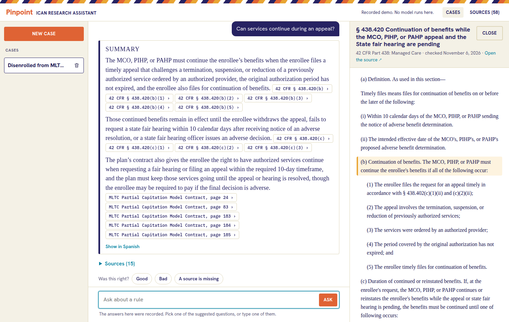
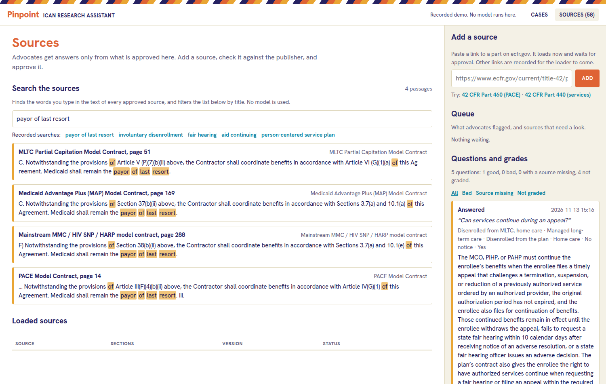

# Pinpoint

A case research tool for helpline advocates who work on Medicaid managed care cases. An advocate asks about a rule; Pinpoint shows the rule in the source's own words with its citation, and a short written summary on top. It does not give advice on a case.

Built for the [AI for Health Equity Design Sprint](https://datascience.columbia.edu/events/ai-health-equity-design-sprint), hosted by the Data Science Institute at Columbia University in November 2026, with the [Community Service Society of New York](https://www.cssny.org/) as community partner. Every case detail used with Pinpoint is made up.

**Recorded demo:** https://pinpoint.mcheng.dev. The two screens with answers recorded from the running tool on 2026-11-13. No model or server is behind it: pick one of the suggested questions and its recorded answer plays back. Cases, grades and outcomes are kept in your own browser.

## What it looks like

The case record: an advocate's own reference and five case facts.


Research: a question, a short written summary, and each citation opened in the source.


Grades and the outcome of the case.


An answer with one of its citations open in the source:



Keyword search across every approved source, with no model:



## What it does

- **Case record.** A case has the advocate's own reference and five case facts (plan type, what happened, service at issue, notice received, services still in place), plus an outcome. There is no field for a name, an ID number or an address.
- **Research.** Names, dates, phone numbers, addresses and ID numbers are removed from a question before anything is searched or sent to a model. The search reads only sources that have been approved. Each sentence of the summary cites the line it rests on, and code checks that the line was offered and that every figure in the sentence appears in it. The summary can be shown in Spanish.
- **Grades.** The advocate marks each answer good, bad, or missing a source.
- **Sources.** One screen to add a source, approve or retire it, check it against the publisher, search the text of every approved source by keyword, and review every question with its grade.

## Run it

Python 3.12 or 3.13.

```
python -m venv .venv
.venv/bin/pip install -r requirements.txt
.venv/bin/python -I app/ingest.py data/ecfr data/oracle.db
.venv/bin/python app/server.py 8000
```

Open http://localhost:8000. Without a larger model the tool shows the matching passages and no written summary.

To have summaries written, name a model in one setting:

```
PINPOINT_LLM=bedrock:openai.gpt-oss-120b-1:0   # Amazon Bedrock; uses PINPOINT_AWS_PROFILE, or the machine's own role when that is empty
PINPOINT_LLM=openai:<model id>                 # any service that speaks OpenAI's chat format; PINPOINT_OPENAI_KEY, PINPOINT_OPENAI_URL
```

## What is in this repository

- `app/`: the server, search, redaction, summary writing, case record and the two screens.
- `app/record_demo.py`, `app/build_demo.py`, `app/web/demo.js`: record answers from a running copy and build the recorded demo.
- `demo/recording.json`: the recording. `docs/`: the recorded demo as built, and the images above.
- `data/ecfr/`: two federal regulations (42 CFR Part 438 and Part 431 Subpart E) as published on ecfr.gov, to build a first database from. More sources are added on the Sources screen.

The question sets used to test the tool, and the list of sources the helpline supplied, belong to CSSNY and are not included.

## Limits

- Redaction misses some details, such as names typed in capital letters, ages and apartment numbers. Do not rely on it as the only protection for client information.
- The summaries are written by a language model. The cited source text is the authority.
- It is a demonstration, with no sign-in and no access control of its own.

## License

MIT. See `LICENSE`.
